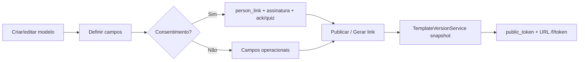
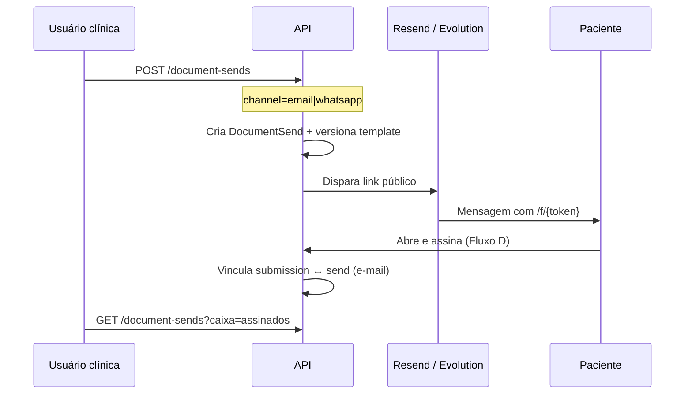
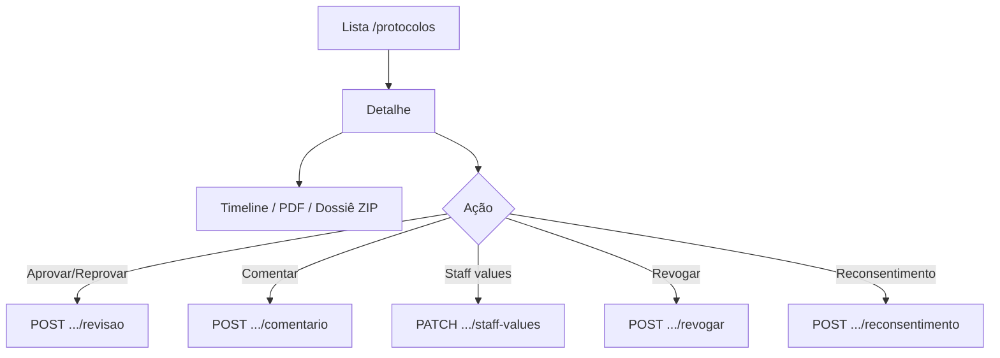
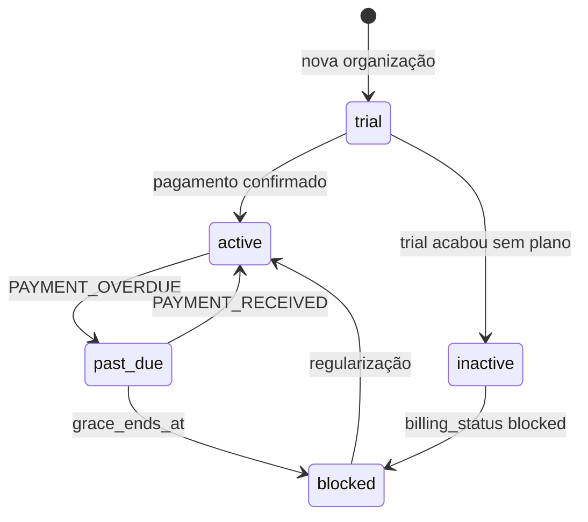

# 03 — Fluxos operacionais e diagramas

**Produto:** Gestgo  
**Objetivo:** documentar os fluxos como o sistema funciona **hoje** (front + API).

---

## 1. Mapa de atores

```text
┌────────────┐   ┌────────────┐   ┌────────────┐   ┌──────────────┐
│ Paciente   │   │ Staff /    │   │ Owner /    │   │ Platform     │
│ (público)  │   │ Recepção   │   │ Manager    │   │ admin        │
└─────┬──────┘   └─────┬──────┘   └─────┬──────┘   └──────┬───────┘
      │                │                │                  │
      ▼                ▼                ▼                  ▼
 /f/{token}      /envios          /templates         /plataforma/*
 /l/{slug}       /pessoas         /protocolos        billing global
 /verificar/*    /protocolos      /clinica/*         integrações
```

---

## 2. Fluxo A — Autenticação e acesso ao tenant

```mermaid
flowchart TD
  A[Login /autenticacao] --> B{Credenciais OK?}
  B -->|Não| A
  B -->|Sim| C[Token Sanctum + /me]
  C --> D{E-mail verificado?}
  D -->|Não| E[/verificacao-pendente]
  D -->|Sim| F{Billing OK?}
  F -->|Bloqueado| G[/assinatura]
  F -->|OK| H[Shell app /dashboard]
  E --> I[Reenviar verificação]
  G --> J[Checkout Asaas]
```

**Notas**

- 403 de e-mail não verificado → redireciona para `/verificacao-pendente`.
- Middleware `tenant.billing`: trial expirado / past_due após grace → soft/hard block.
- Público continua acessível (`/f/*`, webhooks Asaas).

---

## 3. Fluxo B — Publicar modelo e gerar link



**API:** `POST /templates/{id}/link-publico` · `POST /templates/{id}/enviar` · biblioteca `GET /templates/biblioteca`.

---

## 4. Fluxo C — Envio de documento (e-mail / WhatsApp)



**Caixas:** pendentes · assinados · expirados · cancelados.  
**Jobs:** `documents:send-reminders` (schedule diário; `DOCUMENT_REMINDER_DAYS`).

---

## 5. Fluxo D — Paciente no formulário público (consentimento)

Fluxo P0 fechado (ago/2026) — referência de produto.

```mermaid
flowchart TD
  A[GET formulario-publico/token] --> B[POST validate-person]
  B --> C[UI: Confirmo que sou Nome]
  C --> D[Preenche campos + prefill Person]
  D --> E{Tipo consentimento?}
  E -->|Sim| F[Ack / scroll / quiz]
  E -->|Não| G[Campos livres]
  F --> H[Assinatura canvas + aceite]
  G --> H
  H --> I{signing_security_level?}
  I -->|reinforced| J[OTP send/verify]
  I -->|basic| K[Submit]
  J --> K
  K --> L[POST submit]
  L --> M[Protocolo + snapshot + PDF MinIO]
  M --> N[E-mail clínica com PDF]
  M --> O[Token cópia paciente 72h]
  O --> P[/f/sucesso + download]
```

**Identidade (Opção B):** CPF **ou** código da pessoa + data de nascimento → confirmação explícita do nome (`_person_name_confirmed`).

**Cópias**

| Destino | Como |
|---------|------|
| Clínica | E-mail `protocol-new` + PDF em Protocolos / dossiê |
| Paciente | `/f/sucesso` + `GET .../copia/{copyToken}` + e-mail opcional |

---

## 6. Fluxo E — Revisão de protocolo na clínica



Status típicos de submissão: pendente → aprovado / reprovado (+ revogado quando aplicável).

---

## 7. Fluxo F — Cadastro de pessoa e reconsentimento

```text
Pessoas CRUD
  → ficha (PII + hashes)
  → histórico de protocolos / envios
  → solicitar reconsentimento
       → gera novo envio / link com template de consentimento
```

---

## 8. Fluxo G — Billing (Asaas)



- Webhook: `POST /webhooks/asaas` (token `ASAAS_WEBHOOK_SECRET`).
- SPA: `/assinatura` (alias `/billing`).

---

## 9. Fluxo H — Link na bio

```text
Owner configura /link-bio
  → links, aparência, foto, formulários, Google Reviews
  → público: GET /l/{slug}
  → analytics: page_views, link_clicks, cta_clicks
  → redirect /go/{linkId} e /cta/{channel}
```

---

## 10. Fluxo I — Integração Feegow (agendamento)

```text
Clínica: /clinica/integracoes/sistemas/feegow
  → token + teste de conexão
  → catálogos / disponibilidade

Formulário público:
  GET .../feegow/disponibilidade
  → paciente escolhe horário
  → submit pode criar agendamento (API Feegow)
```

---

## 11. Fluxo J — WhatsApp Evolution

```text
/clinica/integracoes (WhatsApp Evolution)
  → criar instância → QR / pair → connect
  → test message
  → usado em envios channel=whatsapp (quando Evolution configurado)
```

Canal alternativo legado: webhook n8n (`N8N_WHATSAPP_WEBHOOK_URL`).

---

## 12. Fluxo K — Plataforma Gestgo

```text
Admin platform
  /plataforma          → KPIs
  /plataforma/clientes → tenants / orgs
  /plataforma/leads    → demonstration_requests
  /plataforma/assinaturas|faturas|planos
  /plataforma/configuracoes → Asaas, MinIO, Resend, Business Hub
  /plataforma/organizacoes-online → presence
```

---

## 13. Diagrama de domínio (simplificado)

```text
Tenant 1──* Organization 1──* User
                 │
                 ├──* FormTemplate 1──* FormField
                 │         │
                 │         └──* FormTemplateVersion
                 │
                 ├──* Person
                 │
                 ├──* DocumentSend ──► FormTemplate / Person?
                 │
                 ├──* FormSubmission (Protocolo)
                 │         ├──* SubmissionValue
                 │         ├──* SubmissionAttachment
                 │         ├──* SubmissionSignature
                 │         └──* SubmissionEvent
                 │
                 ├──* ClinicLink (link-bio)
                 ├──* Subscription / Payment
                 └──* OrganizationRole
```

---

## 14. Rotas SPA relevantes

| Área | Paths |
|------|-------|
| Auth | `/autenticacao`, `/esqueci-a-senha`, `/redefinir-senha`, `/verificar-email`, `/verificacao-pendente` |
| Público | `/f/:token`, `/f/sucesso`, `/l/:slug`, `/verificar/:code` |
| App | `/dashboard`, `/templates/*`, `/envios`, `/protocolos/*`, `/pessoas/*`, `/links-publicos`, `/link-bio` |
| Empresa | `/clinica/configuracoes`, `/clinica/integracoes/*`, `/usuarios/*`, `/organizacao/permissoes/*` |
| Conta | `/assinatura`, `/conta/perfil`, `/notificacoes`, `/novidades` |
| Plataforma | `/plataforma/*` |

---

## 15. Referências

- `docs/GAP_FLUXO_PACIENTE_CONSENTIMENTO.md`
- `zion_med/docs/SPEC_CONCORRENCIA_ASSINATURA_DIGITAL.md`
- `src/app/app.routes.ts`
- `zion_med/routes/api.php`
